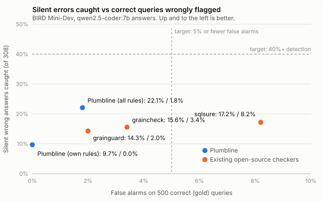

# Plumbline

## The problem

**AI models now write SQL for people who can't check it, and a large share of that SQL
runs without error but returns the wrong answer.**

A database only rejects SQL that is *broken*: a misspelled column, bad syntax. It
happily runs SQL that is *wrong*. Ask an AI "how many locally funded schools...?" and it
writes `WHERE FundingType = 'Locally Funded'`, but the data says `'Locally funded'` (small
f). The query runs, matches nothing or the wrong rows, and the user gets a confident,
wrong number. No error appears anywhere, so nobody finds out.

How big the problem is, measured on this project's own test (BIRD Mini-Dev, 500
questions, local model `qwen2.5-coder:7b`):

| What happened to the 500 AI-written queries | Count |
|---|---|
| Right answer | 46 (9%) |
| Database rejected it (the error is visible) | 144 (29%) |
| **Ran fine, wrong answer (the error is silent)** | **308 (62%)** |

The silent group is the dangerous one. Existing checkers mostly look for one cause,
joins that double-count rows, and the best of them flags 17% of these queries. **None
checks whether the values a query filters on actually exist in the data.** In this test,
35 of the silent errors filter on a value the column never contains, and 15 of those are
caught by no existing tool. Details: [docs/findings-log.md](docs/findings-log.md).

**Who it hurts:** analysts, operations and business teams using "ask your data" tools
and AI agents that query databases directly. Nobody in that loop reads the SQL.

## What Plumbline does

**Checks AI-written SQL against the real data before it runs, and says what to fix.**

Plumbline profiles each database once: which values each column actually holds, their
spelling and case, what IDs look like. Then it checks every AI-written query against that
profile and flags:

- filter values that don't exist (`'Locally Funded'` vs `'Locally funded'`),
- invented IDs and codes (a school code missing its leading zero),
- invented columns and tables,

and returns a repair hint the AI can act on. For join double-counting it relies on the
existing tool [grainguard](https://github.com/rohitchaurasia195-web/GRAINGUARD) rather than
reinventing it.

> Status: v0.1. Baseline, profiler, checks, scoring and packaging are done (M0–M4); the
> agent interface and repair loop (M5) are next.

## Quick start

```bash
pip install "plumbline-sql[fanout] @ git+https://github.com/DerekYHuang/Plumbline@v0.1.0"
plumbline profile shop.sqlite                     # once: learn what the data holds
plumbline check shop.sqlite "SELECT ... WHERE status = 'Finished'"   # every query
```

`check` prints the verdict, the evidence and a fix, and exits 0 (pass), 1 (fail) or 2
(bad input), so it works as a CI gate. From Python: `plumbline.check_sql(sql, catalog)`.

## Results

Measured on BIRD Mini-Dev (500 questions, 11 SQLite databases), with answers written by
`qwen2.5-coder:7b`. Ranges are 95% confidence intervals.

| | Result |
|---|---|
| Silent wrong answers caught before running | **22.1%** (68 of 308; 17.8–27.0%) |
| Correct queries wrongly flagged | **1.8%** (9 of 500; 0.9–3.4%), all from the fan-out rule; **0%** from Plumbline's own rules |
| When Plumbline fails an AI answer, it really is wrong | **99.5%** (195 of 196) |
| Crashing answers stopped before running | 87% (127 of 146) |
| Time per check | 6.9 ms median, 16.3 ms at the 95th percentile |
| One-off profiling, all 11 databases | 6.2 minutes |
| Injected faults caught (correct queries broken on purpose, each one executed to confirm the answer changed) | wrong capitalisation **81%**, value typo **79%**, crashing name typos 97–100%, fan-out 35%; all silent faults **73.6%** (547 of 743) |



**Second model, held out** (`qwen3.5:4b`; rules frozen before its answers were seen):
**25.4%** of its 335 silent wrong answers caught (21.0–30.3%), against 22.1% on the
first model. Plumbline's own rules raised 0 false alarms on its 62 correct answers. This
model made fewer value mistakes and more join mistakes, so fan-out caught more and the
value rules less. The model itself scored 12.4% (vs 9.2%; paired McNemar p = 0.04). It is
a thinking model, so its 145 answers that ran out of room were re-run with a larger
answer limit.

**What it doesn't catch:** half of the missed wrong answers are *intent* errors (the AI
misread the question), which no check on data or schema can see. Details, and every
flagged query read by hand: [docs/m3-hand-review.md](docs/m3-hand-review.md).
> Every number in this README is measured, with the benchmark and model named.
> Milestone reviews: [docs/milestones/](docs/milestones/).

## Reproduce the numbers (one command)

```bash
git clone https://github.com/DerekYHuang/Plumbline && cd Plumbline
pip install ".[fanout]"
python -m bench.reproduce            # --all for both models
```

It downloads [BIRD Mini-Dev](https://github.com/bird-bench/mini_dev) from its official
sources (~806 MB, once), checks every file against the SHA-256 hashes in
[bench/data_manifest.json](bench/data_manifest.json), builds the catalogs, re-executes the
model's committed answers, re-runs Plumbline, and prints PASS or MISMATCH for each
headline number. It takes about 25 minutes plus the download. It doesn't call the model
again: the exact answers the numbers came from are committed in
[results/predictions/](results/predictions/), with the model digest and settings.

Or with Docker (nothing installed but Docker; the data folder is mounted, not baked in):

```bash
docker build -t plumbline .
docker run --rm -v "$PWD/data:/app/data" plumbline
```

The same run happens on GitHub: **Actions → Reproduce results → Run workflow**
([reproduce.yml](.github/workflows/reproduce.yml)), and monthly on its own.

## Development

Requires Python 3.11+.

```bash
python -m venv .venv
.venv\Scripts\activate          # Windows  (macOS/Linux: source .venv/bin/activate)
pip install -e ".[dev]"
pre-commit install              # lint runs before every commit, same as CI
pytest -q
python -m bench.fetch_data      # BIRD Mini-Dev into data/bird_mini_dev/ (gitignored)
```

The BIRD data (1.5 GB, CC BY-SA 4.0) isn't bundled in this MIT-licensed repo;
`fetch_data` downloads it from the source and verifies it. Put it elsewhere with `PLUMBLINE_BIRD_DIR`.

## Check a query (M2)

```bash
plumbline check california_schools.json \
  "SELECT COUNT(*) FROM schools WHERE FundingType = 'Locally Funded'"
```

```
FAIL (1 errors, 0 warnings)

  [error] VALUE_CASE: 'Locally Funded' is not a value of schools.FundingType; the data
          has 'Locally funded' (differs only in capitalisation or spaces).
    hint: Use 'Locally funded'.
```

Exit code 0 = pass, 1 = fail, 2 = bad input; `--json` for the full structured result.
From Python: `plumbline.check_sql(sql, Catalog.load(path))`.

| Rule | Catches |
|---|---|
| `VALUE_CASE` | right value, wrong capitalisation or spaces |
| `VALUE_MISSING` | a value the column never holds (with "did you mean") |
| `VALUE_FORMAT` | a code or date in the wrong format (e.g. a missing leading zero) |
| `LIKE_NO_MATCH` | a `LIKE` pattern that matches no value |
| `SCHEMA_TABLE` / `SCHEMA_COLUMN` | invented tables and columns |
| `SCHEMA_ALIAS` | one alias for two tables, which SQLite silently accepts |
| `FANOUT` / `CHASM` | totals inflated by a join (via [grainguard](https://github.com/rohitchaurasia195-web/GRAINGUARD), optional extra `[fanout]`) |

How well these rules work is measured in [Results](#results). Design notes:
[docs/milestones/m2-review.md](docs/milestones/m2-review.md).

## Profile a database (M1)

```bash
plumbline profile data/bird_mini_dev/.../california_schools.sqlite -o california_schools.json
python -m bench.profile_all      # all 11 BIRD databases + a 10-column hand-check
```

The catalog records, for every column: row, null and distinct counts, uniqueness, number
and date ranges, the full value list when there are at most 200 values, and text formats
such as `9{14}` (a 14-digit code). Profiling all 11 BIRD databases (798 columns) takes
about 6 minutes on a home PC. See [docs/milestones/m1-review.md](docs/milestones/m1-review.md).

## Run the M0 baseline

Needs [Ollama](https://ollama.com) running locally.

```bash
ollama pull qwen2.5-coder:7b
python -m bench.verify_gold                        # all 500 gold queries should PASS
python -m bench.generate --run-id smoke --limit 20 # quick end-to-end check
python -m bench.score smoke
python -m bench.generate --run-id qwen7b-r1        # full run (hours on a GTX 1060; resumable)
python -m bench.score qwen7b-r1
```

See [docs/m0-baseline.md](docs/m0-baseline.md) for what each step does and how to read
the output.

## License

Code: MIT (see [LICENSE](LICENSE)). The BIRD Mini-Dev benchmark used for evaluation is
CC BY-SA 4.0 (© its authors, [bird-bench/mini_dev](https://github.com/bird-bench/mini_dev));
it isn't bundled here and is downloaded from its source.
