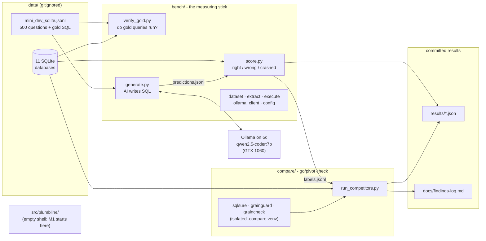

# M0 review: baseline and go/pivot check

Finished 2026-11-15. Detailed evidence lives in [findings-log.md](../findings-log.md); this
page is the short version.

## What M0 did, in plain words

**Question M0 answered:** before building anything, how often does an AI model write SQL
that's wrong, in what ways, and does a tool that catches it already exist?

1. **Got a test set.** BIRD Mini-Dev: 500 questions about 11 real databases (schools,
   card games, a bank, a hospital...), each with a known-correct SQL answer ("gold").
2. **Checked the test set.** Ran all 500 gold queries on our copy of the databases. All
   worked.
3. **Set up a local AI.** Installed Ollama on the G: drive and downloaded
   `qwen2.5-coder:7b`, a free model that runs on the GTX 1060.
4. **Let the AI answer all 500 questions** (about 4 hours), then ran each of its queries
   and compared the result with the gold answer.
5. **Result: 9.2% correct.** Of the 454 wrong queries, 144 crashed (easy to spot) and
   **308 ran fine but gave a wrong answer** (silent, which is the dangerous kind).
6. **Tested the competition.** Ran three existing checkers (sqlsure, grainguard,
   graincheck) on those 308 silent errors. The best flagged 17%. All three look mainly
   for one bug type (joins that double-count). None checks whether filter values exist.
7. **Decision: GO, repositioned.** Plumbline focuses on value and schema checks, which
   nobody covers, and leaves double-counting to grainguard.

## Project structure after M0

`bench/runs/` holds the raw outputs of each run (gitignored, since it's regenerated from the
code). The `tests/` folder holds 30 unit tests for the bench code.

## Problems we hit, and the alternatives

### 1. The C: drive is almost full (14 GB free)

- **What we did:** installed Ollama to `G:\Ollama` and set `OLLAMA_MODELS=G:\Ollama\models`
  so models download to G:.
- **Alternatives:**
  - Keep the default install and only move the models. The Ollama FAQ documents
    `OLLAMA_MODELS` for exactly this.
  - Install somewhere else with the installer's `/DIR` flag, as the Ollama Windows docs show.
  - Move the folder and leave a symbolic link behind. This works but is fragile across
    updates.
- **Verdict:** what we did follows the official route. Moving the models alone would have
  been enough.
- **Sources:** [Ollama FAQ](https://docs.ollama.com/faq.md),
  [Ollama on Windows](https://docs.ollama.com/windows)

### 2. Ollama crashed on the GPU

- **What happened:** Ollama's CUDA backend (its normal NVIDIA path) crashed with "PTX
  compiled with an unsupported toolchain". Driver 555.85 was older than what that Ollama
  build needs.
- **What we did:** first a temporary workaround through Ollama's Vulkan backend. Then you
  updated the driver to 582.78 and CUDA worked.
- **Alternatives:**
  - Vulkan, which ran at the same speed here. Ollama's Windows docs list Vulkan as a
    supported fallback. The `OLLAMA_VULKAN=1` switch we used isn't in the official docs,
    though, so don't rely on it long term.
  - CPU only. It always works but is several times slower (not measured on this
    machine).
  - Install an older Ollama version that matches the old driver. That gets no fixes.
- **Verdict:** the driver update was the right fix. Keep Vulkan as the fallback.
- **Sources:** [Ollama on Windows](https://docs.ollama.com/windows)

### 3. One gold query took 28 s, close to the 30 s time limit

- **What we did:** raised the limit to 60 s, so a busy PC can't mark a correct query
  "timeout".
- **Alternative:** BIRD's official efficiency metric (R-VES) uses a short timeout and
  repeats each query 5 times. That measures *speed*, not correctness, so we don't need it.
- **Source:** [BIRD Mini-Dev repo](https://github.com/bird-bench/mini_dev)

### 4. The first test said 0 out of 20 correct, which looked like a bug

- **What we did:** read the actual answers before trusting the number. The pipeline was
  fine; the AI really was wrong.
- **Lesson:** a near-zero score usually means a bug, so always read examples. The runbook
  now says so.

### 5. 9.2% is low, because our question set is unusually hard

- **What happened:** the Hugging Face file we used is a revised 2026 release ("Mini-Dev
  1024") with **460 challenging, 32 moderate and 8 simple** questions. The original 2024
  Mini-Dev mixes them **148 / 250 / 102** (30% / 50% / 20%), and published scores use
  that version.
- **Alternatives:**
  - **Original Mini-Dev.** It's already on your disk inside `minidev.zip`
    (`MINIDEV/mini_dev_sqlite.json`, 500 questions). Its score is comparable to the
    leaderboard. The catch: that file has no ready-made prompts, so we'd write BIRD's
    prompt format ourselves.
  - **Full BIRD dev**, 1,534 questions. A 2026 study reports about 39% for small
    Qwen2.5-Coder models there, which gives a reference point. It would take about 3 times
    as long to run.
  - **Keep the hard set.** For Plumbline this is arguably *better*: more silent errors
    means more test cases for the checker.
- **Verdict:** keep the hard set for building and testing checks. Run the original
  Mini-Dev once if you want a number that's comparable to published results (about
  4 hours).
- **Sources:** [BIRD Mini-Dev repo](https://github.com/bird-bench/mini_dev),
  [on-prem open LLMs on BIRD (2026)](https://arxiv.org/pdf/2606.29733)

### 6. The scoring rule is strict

- **What happened:** "correct" means the result rows match the gold answer exactly. An
  answer with an extra column, or rounded differently, counts as wrong.
- **Alternatives:**
  - **Soft F1**, BIRD's own lenient metric, which gives partial credit row by row.
  - **Test-suite accuracy** (Zhong et al., 2020), which runs both queries on several
    versions of the database to catch answers that only match by luck.
- **Verdict:** this doesn't matter for Plumbline. We care whether the *checker* catches
  wrong queries, not the AI's exact score. Strict scoring does push some near-miss answers
  into the "silent error" group, which is why we check samples by hand.
- **Sources:** [BIRD Mini-Dev repo](https://github.com/bird-bench/mini_dev) (Soft F1),
  [Zhong et al., Semantic Evaluation for Text-to-SQL with Distilled Test Suites](https://arxiv.org/abs/2010.02840)

### 7. Should the blueprint's runs r2 and r3 still happen?

- **What happened:** the blueprint asks for 3 runs to show a spread. Our runs use
  temperature 0, which makes the model always pick its single most likely next word. At
  temperature 0 **the seed is ignored**, so r2 (seed 43) and r3 (seed 44) would come out
  almost identical to r1. That would be 8 hours of GPU time to learn very little.
- **But temperature 0 isn't perfectly repeatable either.** Atil et al. found accuracy can
  still drift by up to 10% between runs, from tiny GPU arithmetic differences.
- **Alternatives:**
  - **A confidence interval from r1** (done, free). 46/500 correct gives a 95% interval
    of **7.0% to 12.1%** (Wilson method). That's an honest "how much could this number
    move" answer.
  - **A short repeat run.** Rerun 50 questions once (about 25 minutes) and count how many
    answers changed. That measures real drift cheaply.
  - **Sampled runs.** Temperature 0.7 with 3 seeds gives a genuine spread, but these aren't
    the model's "best" answers.
- **Verdict:** **skip r2 and r3.** Report the interval. Spend the 4 GPU hours on the
  original Mini-Dev (problem 5) if you want a comparable number.
- **Sources:** [Atil et al., Non-Determinism of "Deterministic" LLM Settings](https://arxiv.org/abs/2408.04667),
  [Dylan Castillo, Controlling randomness: temperature and seed](https://dylancastillo.co/posts/seed-temperature-llms.html)

### 8. Competitors already exist

- **What happened:** sqlsure, grainguard and graincheck all launched July to October 2026,
  all built around join double-counting.
- **What we did:** measured them on our errors (the best flags 17%) and repositioned
  Plumbline around value checks, which none of them do.
- **Why value checks are worth it:** CHESS, a top BIRD system, found that looking up real
  database values improved accuracy by about 5 points. That confirms wrong values are a
  known, important failure, though it was handled *during* generation. Plumbline checks
  values *after* generation, for any AI.
- **Alternatives:** contribute a value rule to an existing tool. grainguard (MIT) is the
  cleanest candidate, but its design only reasons about SQL text and never reads data,
  so a value rule doesn't fit it.
- **Sources:** [CHESS (Talaei et al., 2024)](https://arxiv.org/abs/2405.16755), plus the
  comparison in [findings-log.md](../findings-log.md)

## Open decisions for Derek

1. ~~Skip r2 and r3 and report the 7.0% to 12.1% interval instead?~~ **Decided
   2026-11-15: skipped.** The baseline is reported as 9.2% (95% CI 7.0% to 12.1%).
2. Run the original 2024 Mini-Dev once for a leaderboard-comparable number? (Optional,
   about 4 hours of GPU time.)
