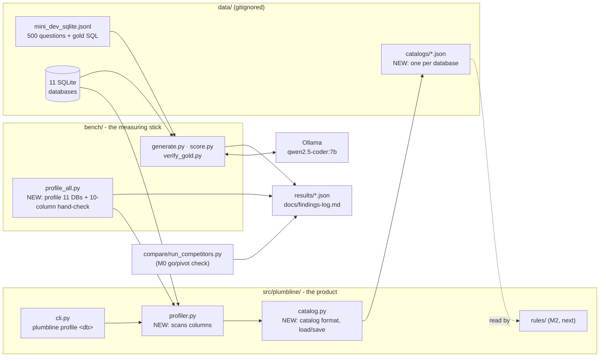

# M1 review: the profiler

Finished 2026-11-15. Command: `plumbline profile <db.sqlite>`. Code:
[profiler.py](../../src/plumbline/profiler.py), [catalog.py](../../src/plumbline/catalog.py).

## What M1 did, in plain words

**Goal:** before Plumbline can say "this value doesn't exist", it has to know which values
*do* exist. M1 builds that knowledge.

1. **Built a profiler.** It reads a database once and writes down, for every column:
   - how many rows, empty cells and different values it has;
   - whether every value is unique (an ID column);
   - its smallest and largest number or date;
   - **the full list of values**, when there are 200 or fewer different ones (e.g.
     `FundingType` = `Directly funded` / `Locally funded` / `Not in CS funding model`);
   - the **"shape"** of its text, so formats are visible. A school code is `9{14}`
     (14 digits), a date is `9{4}-9{2}-9{2}`.
2. **Saved it as a "catalog":** one small JSON file per database (1.7 MB for all 11).
   The M2 checks will read only this file, never the database itself.
3. **Added the command** `plumbline profile <db>`.
4. **Tested it:** 22 new unit tests on a tiny made-up database (53 tests in total, all
   passing).
5. **Ran it on all 11 BIRD databases:** 798 columns in **6.2 minutes**. 456 columns (57%)
   got a complete value list.
6. **Hand-checked it.** Picked 10 random columns and recounted them with separately
   written SQL. **10/10 matched.**

**Why it matters:** the catalog already holds what's needed to catch the M0 failures.
`FundingType` really is `'Locally funded'` (small f), card `watermark` values are
lowercase (`'boros'`, not `'Boros'`), and every school code has 14 digits, so the
model's 13-digit codes stand out.

## Project structure after M1

New in M1: everything in the **profiling** box, plus `bench/profile_all.py`.

## Problems we hit, and the alternatives

### 1. DuckDB or SQLite to do the profiling?

- **What happened:** the blueprint suggests DuckDB for speed, but allows plain SQLite "if
  it costs you time".
- **What we did:** used Python's built-in `sqlite3`. No new dependency, and every
  statistic is one SQL query.
- **Alternatives:**
  - **DuckDB**, which can attach a SQLite file directly. Its column-oriented engine is
    built for exactly these whole-column statistics. The catch, from its own docs: SQLite
    lets a column declared `INTEGER` hold text, and when DuckDB meets that it fails with a
    "Mismatch Type Error" unless you read every column as text (`sqlite_all_varchar`).
    The BIRD databases turned out to have **no** such columns (0 of 798), so DuckDB would
    have worked here. Real company databases often do.
  - **A profiling library** such as ydata-profiling. It's richer, but heavy, built for
    reports rather than machine-readable catalogs, and it doesn't keep exact value lists
    for matching.
- **Verdict:** keep `sqlite3` for the MVP. Revisit DuckDB if speed becomes a problem
  (problem 2).
- **Sources:** [DuckDB SQLite extension](https://duckdb.org/docs/2.0/core_extensions/sqlite.html),
  [SQLite: datatypes and type affinity](https://www.sqlite.org/datatype3.html)

### 2. Wide tables are slow (one database took 2.8 minutes)

- **What happened:** `european_football_2` has 199 columns. The profiler reads the
  whole table about 5 times *per column*, so its big `Match` table (with large XML text
  columns) is read hundreds of times. That one database took 169 s of the 374 s total.
- **What we did:** accepted it. 6.2 minutes for everything meets the blueprint's
  "finishes in minutes", and profiling runs once, not per query.
- **Alternatives:**
  - **One pass per table instead of per column.** Put every column's
    `COUNT(DISTINCT ...)` in a single SELECT. This is likely a several-times speed-up, but
    not measured yet.
  - **DuckDB** (problem 1), which reads only the columns it needs.
  - **Approximate distinct counts (HyperLogLog).** These use tiny memory and a few percent
    error. DuckDB has them built in as `approx_count_distinct`. Good for terabyte tables
    (an interview question in the blueprint), but the value check needs *exact* lists,
    so this only helps the counts.
  - **Sampling** large tables: fast, but it can miss rare values, which are exactly the
    ones a value check needs.
- **Verdict:** fine for now. For huge tables, the plan is one pass per table plus exact
  value lists only for low-cardinality columns.
- **Sources:** [Flajolet et al., HyperLogLog (2007)](https://algo.inria.fr/flajolet/Publications/FlFuGaMe07.pdf),
  [MotherDuck: HyperLogLog in DuckDB](https://motherduck.com/glossary/hyperloglog/)

### 3. Where to draw the line for "few enough values to list"

- **What we did:** keep the full list when a column has 200 or fewer different values.
  Above that, keep the 20 most common (for repair hints). 57% of BIRD columns got a full
  list, including every category-like column we needed for the M0 failures (`watermark`
  has 161).
- **Alternatives:**
  - **A ratio** (distinct values ÷ rows), which treats big and small tables alike.
  - **Always store everything,** which makes catalogs large on big text columns.
  - **A value index**, as CHESS does with locality-sensitive hashing (LSH). It scales to
    millions of values and finds near-matches, but it's a different, heavier piece of
    machinery.
- **Verdict:** keep the fixed limit. Columns above it (IDs, names) get checked by
  **shape** in M2 (e.g. "14 digits") instead of by list.
- **Sources:** [Abedjan, Golab & Naumann, *Profiling relational data: a survey*, VLDB J. 2015](https://dspace.mit.edu/handle/1721.1/106176)
  (the standard reference for what a column profile contains: nulls, distinct counts,
  value patterns), [CHESS](https://arxiv.org/abs/2405.16755)

### 4. Shapes come from the first 1,000 values, not a random sample

- **What happened:** for speed, a column's text shapes come from the first 1,000 distinct
  values SQLite returns, not a random 1,000. Shapes for multi-word text are also noisy
  (each word length is part of the shape), so they're only useful for codes, IDs and dates.
- **Alternatives:**
  - **A random sample** (`ORDER BY RANDOM()`), which is slower on big tables.
  - **Reservoir sampling** in Python: random and one pass, slightly more code.
  - **Coarser shapes** that drop the counts (`9-9-9`), which are more robust but lose the
    "14 digits" signal.
- **Verdict:** fine for M2's first version. If a shape check misfires in M3, switch to
  reservoir sampling.
- **Source:** [Abedjan et al. 2015](https://dspace.mit.edu/handle/1721.1/106176)
  (pattern discovery as a profiling task)

### 5. A catalog goes out of date when the data changes

- **What we did:** each catalog records the database file's size and modification time,
  and `Catalog.is_stale()` notices when either changes (tested).
- **Alternatives:**
  - **SQLite's `PRAGMA data_version`**, but it only detects changes during one open
    connection, not between program runs.
  - **A hash of the whole file:** exact, but slow on big files.
  - **Re-profile on a schedule:** simple, but it can be stale between runs.
- **Verdict:** size and time are a good cheap guard. A stale catalog should *warn*, not
  block, in M2.
- **Source:** [SQLite PRAGMA data_version](https://www.sqlite.org/pragma.html#pragma_data_version)

### 6. The catalog contains real data values

- **What happened:** value lists are copies of real data. For BIRD that's a licensing
  question (the data isn't ours to republish); for a company it could be private
  information.
- **What we did:** catalogs go to `data/catalogs/`, which is gitignored. Only timings and
  the hand-check results are committed.
- **Alternatives:**
  - **Skip value lists for columns marked sensitive,** as sqlsure's `SENSITIVE_COLUMN`
    rule marks PII.
  - **Store hashes instead of values:** this can still say "doesn't exist", but loses
    "did you mean ...?" hints.
- **Verdict:** gitignore is enough for the MVP. Add a "don't store values" option before
  any real-company use.

### 7. CI had been failing since M0

- **What happened:** the M0 comparison script broke the lint step (9 style errors). We
  didn't notice because nobody looked at CI.
- **What we did:** fixed it, and reran that script to confirm the result was unchanged
  (139, same as before).
- **Alternative:** a pre-commit hook that runs `ruff` before every commit, so this can't
  recur.
- **Verdict:** worth adding. It's a five-minute job.

## Open decisions for Derek

1. Add a pre-commit hook for lint? (Recommended, small.)
2. Speed up wide tables now (one pass per table), or leave it until it matters?
   (Recommended: leave it.)
