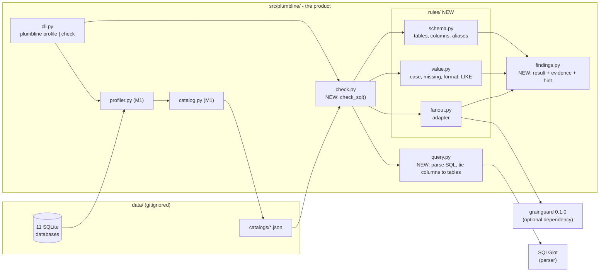

# M2 review: the checks

Finished 2026-11-15. Command: `plumbline check <db or catalog> "<SQL>"`. Library:
`plumbline.check_sql(sql, catalog)`. Code: [query.py](../../src/plumbline/query.py),
[rules/](../../src/plumbline/rules/), [check.py](../../src/plumbline/check.py).

## What M2 did, in plain words

**Goal:** given an AI-written query and the catalog from M1, say *before it runs* whether
it's likely to give a wrong answer, why, and how to fix it.

1. **Taught Plumbline to read SQL.** The query is turned into a tree (with the SQLGlot
   library) and every column is tied to its real table, even through aliases,
   subqueries and `WITH` blocks.
2. **Built three checks.**
   - **Schema:** tables, columns and aliases that don't exist or clash.
     `FundingTypes` → "did you mean `FundingType`?"
   - **Value (the main one):** filter values the column never holds.
     - `'Locally Funded'` → "use `'Locally funded'`".
     - A 13-digit school code → "codes have 14 digits; try `'01611920113902'`".
   - **Fan-out:** totals inflated by a join. We plug in grainguard (from the M0
     comparison) instead of rebuilding it, and feed it what our profiler measured.
3. **Every finding comes with evidence and a hint** that a person or an AI can act on.
   A query **fails** only on an error; warnings mark things that are merely suspicious.
4. **Added `plumbline check`.** It exits with 0 = pass, 1 = fail and 2 = bad input, so
   it can block a CI build.
5. **Tested it:** 53 new tests, at least 10 per rule (half must pass, half must fail).
   106 tests in total.
6. **Ran it on all of M0's queries as a sanity check.** This found and fixed 3 real bugs
   (below). Preliminary numbers; M3 does the formal scoring:

| | Flagged as failing |
|---|---|
| 308 silent wrong answers | **71 (23%)**, vs the best single existing tool's 17% in M0 |
| 500 correct gold queries (false alarms) | **9 (1.8%)**, all from the fan-out rule |
| ...from Plumbline's own schema + value rules only | **33 silent errors caught, 0 false alarms**; 30 of the 33 are missed by fan-out |
| 144 crashing answers | 113 flagged *before running*, with a fix hint |
| Speed | 6.8 ms per query (median), 16 ms (95th percentile) |

## Project structure after M2

The `bench/` and `compare/` folders are unchanged since M1.

## Problems we hit, and the alternatives

### 1. How to understand the SQL at all

- **What we did:** used SQLGlot to parse the query, then its `qualify` step to fill in
  missing table prefixes from the catalog, and its scope walker to see which table
  each column comes from.
- **Alternatives:**
  - **sqlparse.** It's popular but, by its own docs, a *non-validating* parser: it
    splits text into tokens but doesn't know which table a column belongs to.
  - **Ask SQLite itself with `EXPLAIN <query>`.** This compiles the query without
    running it, and gives exact "no such column" errors for free. But it needs the live
    database, gives no "did you mean", and says nothing about values. It's a good
    *extra* check, not a replacement.
  - **Regular expressions:** fail on aliases, subqueries and quoted names. The blueprint
    rules them out.
- **Verdict:** SQLGlot was right. The one cost is that it lower-cases names, so every
  catalog lookup ignores case (which SQLite does anyway).
- **Sources:** [SQLGlot](https://github.com/tobymao/sqlglot),
  [sqlparse docs](https://sqlparse.readthedocs.io/en/latest/),
  [SQLite EXPLAIN](https://www.sqlite.org/lang_explain.html)

### 2. Real SQL is trickier than test SQL (3 bugs found by the sanity run)

The sanity run over the 1,000 real queries found three bugs that the hand-written tests
didn't:

- **(a) A crash on an unterminated string** (`IN ('140', '141', ...`). SQLGlot raises a
  `TokenError`, and I had only caught its `ParseError`. Now any SQLGlot error becomes a
  clean "parse error" result.
- **(b) The same alias for two tables** (`JOIN disp d ... JOIN district d`, M0 q236 and
  q212). SQLite *runs* this and silently picks a table per column. My resolver
  wrongly reported "column A11 not in disp". It's now its own finding, `SCHEMA_ALIAS`:
  a genuine silent bug the original design missed.
- **(c) A column inside a subquery that belongs to the outer query** (a "correlated
  reference"). This is valid SQL, but it was reported twice and could be wrongly called
  unknown. Each column is now resolved once, innermost query first, then outward.
- **Alternative:** property-based testing with Hypothesis, which generates thousands of
  odd queries automatically. The blueprint has it for week 5. Running on the real M0
  answers did the same job cheaply this time.
- **Lesson:** always run new code on the real data before calling it done.
- **Source:** [Hypothesis](https://hypothesis.readthedocs.io/)

### 3. The one false alarm from our own rules (q496), and the danger of overfitting

- **What happened:** the gold query for q496 filters
  `element IN ('na','k','ca','cu','zn','sn','pb','mg','li')`. 'mg' and 'li' never occur
  in that database, so the value rule called the correct query wrong.
- **What we did:** if an `IN` list contains at least one value that does exist, a missing
  item can't change the result. So it's now a *warning*. Case mismatches stay errors,
  because `'kern'` in a list really does drop the Kern rows. Result: 0 false alarms from
  our own rules, and no true catches lost.
- **Be honest about this:** the change was made *after* seeing q496, which is a form of
  tuning on the test set. The reasoning is general (it's about SQL meaning, not this
  one query). The clean fix is M3's planned **mutation test set**, where faults are
  injected into correct queries, so rules are judged on data they weren't tuned on.
- **Alternative:** keep it as an error and accept a 0.2% false-alarm rate. That's
  defensible, but it makes the tool noisier for no gain.

### 4. Which mistakes are "errors" and which are "warnings"

- **What we did:** an **error** is only raised when the catalog *proves* the filter
  can't match. Examples: the value isn't in a complete list, or the text is longer than
  any stored value. A **warning** means "probably wrong": a date format that differs
  from the sampled formats, or `!=` a value that doesn't exist (useless, not wrong).
- **Alternative:** a single 0–1 confidence score per finding, as graincheck does with
  separate impact / evidence / confidence ratings. It's richer but harder to act on.
  An agent needs a yes/no.
- **Verdict:** keep two levels. M3 measures how often each one is right.
- **Source:** [graincheck](https://pypi.org/project/graincheck/)

### 5. Fan-out depends on a young outside library

- **What happened:** grainguard is version 0.1.0 from a single author. It's also the
  source of all 9 gold false alarms. And it only flags a join when the joined table has
  a *known* unique key: a table without one is silently skipped (found while testing).
- **What we did:**
  - pinned it exactly (`==0.1.0`) and made it optional;
  - fed it every column the profiler *measured* to be unique, not just declared keys;
  - wrapped it so a crash inside it can't break a check.
- **Alternatives:**
  - **Vendor it** (copy the code in; MIT allows this). It's safer against upstream
    changes, but then we maintain it.
  - **Detect multi-column unique keys in the profiler** (e.g. `(cds, rtype)`). This is
    the "unique column combination" task from the data profiling literature, and costs
    one query per column pair.
  - **Write our own fan-out rule.** The go/pivot decision says no.
- **Verdict:** keep the adapter. In M3, report fan-out numbers separately so its noise
  doesn't blur the value rule's results.
- **Sources:** [grainguard](https://github.com/rohitchaurasia195-web/GRAINGUARD),
  [Abedjan et al. 2015 (unique column combinations)](https://dspace.mit.edu/handle/1721.1/106176)

### 6. "Did you mean ...?" hints are simple string similarity

- **What we did:** used Python's built-in `difflib` (edit distance, ignoring case), as
  the blueprint suggests. It works well for typos and case (`'Orang'` → `'Orange'`).
- **Where it's weak:** abbreviations and translations. `'SANCO'` → `'SANKC. UROK'` is
  a guess; the Czech bank codes need domain knowledge.
- **Alternatives:**
  - **Jaro-Winkler similarity,** which is better for short codes.
  - **Embeddings,** which can match meaning, but the blueprint says only if edit
    distance proves too weak.
  - **CHESS-style LSH indexes** for very large value sets.
- **Verdict:** fine for now. M3 can measure how often a hint, applied as-is, fixes the
  query.
- **Sources:** [Python difflib](https://docs.python.org/3/library/difflib.html),
  [CHESS](https://arxiv.org/abs/2405.16755)

## Open decisions for Derek

1. M3 adds the mutation test set (inject one known fault into correct queries) to fix the
   problem-3 overfitting risk. (Recommended.)
2. Keep grainguard as a pinned optional dependency, or vendor it? (Recommended: keep it
   pinned.)
