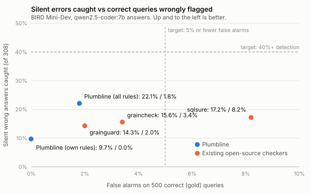
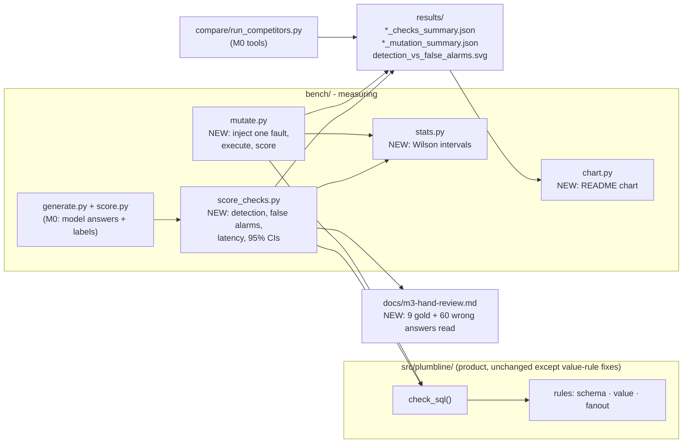

# M3 review: scoring the checks

Finished 2026-11-16. Commands: `python -m bench.score_checks <run>`,
`python -m bench.mutate build|score`, `python -m bench.chart`. Raw numbers in
`results/`; query-by-query reading in [../m3-hand-review.md](../m3-hand-review.md).

## What M3 did, in plain words

**Goal:** turn "it seems to work" into numbers someone else can check, and find out
what Plumbline misses and why.

1. **Scored every check against what really happened.** For all 500 questions,
   Plumbline checked the correct (gold) query and the model's query. The verdict was
   compared with the M0 label (did the query actually give the right answer?). Every
   rate carries a 95% margin of error.
2. **Read the queries, not just the counts:**
   - the 9 gold queries Plumbline flags (is the answer key wrong?);
   - 30 flagged and 30 unflagged wrong answers.
   This found and fixed two more value-rule bugs.
3. **Built a mutation test set.** Take each correct query, break it in one known way
   (wrong capitalisation, a typo, a dropped leading zero...), run it to confirm the
   answer really changes, and check whether Plumbline catches it. These are faults
   the rules were *not* tuned on.
4. **Compared with the existing tools** in one chart.
5. **Prepared the second model.** `qwen3.5:4b` works with the pipeline; Derek runs it
   (about 4 hours).

## Results

| Metric | Result | Blueprint target |
|---|---|---|
| Silent wrong answers caught | **22.1%** (68/308; 95% CI 17.8–27.0) | 40% or more: **not met** |
| ...by Plumbline's own value + schema rules | 9.7% (30/308) | |
| ...by the fan-out rule (grainguard) | 13.3% (41/308) | |
| False alarms on 500 correct gold queries | **1.8%** (9/500; 0.9–3.4) | 5% or less: met |
| ...from Plumbline's own rules | **0.0%** (0/500; 0–0.8) | |
| When Plumbline fails a model answer, it really is wrong | **99.5%** (195/196) | |
| Crashing answers stopped before running | 87% (127/146) | report it |
| Time per check | median 6.9 ms, p95 16.3 ms | under 50 ms p95: met |
| Profiling all 11 databases | 6.2 min | under 10 min: met |

**Mutation set:** 1,637 mutants built from the 500 gold queries (1,584 kept). 53 "equivalent"
mutants (the fault didn't change the answer) were discarded; every one kept was
executed and really gives a wrong answer or crashes.

| Fault injected | Silent mutants caught | Crashing mutants caught |
|---|---|---|
| Wrong capitalisation of a filter value | **81%** (256/315) | – |
| Typo in a filter value | **79%** (191/241) | – |
| Leading zero stripped from a code | 2/2 (too few to judge) | – |
| Column name typo | 65% (70/107) | 97% (330/342) |
| Table name typo | 1/1 | 99.6% (497/499) |
| `COUNT(DISTINCT x)` → `COUNT(x)` (fan-out) | **35%** (27/77) | – |
| **All silent faults** | **73.6%** (547/743; 70.3–76.7) | |

Why value faults get missed (the 120 missed case/typo mutants, diagnosed):
- **91: the column has more than 200 values** (player names, cities), so there's no
  complete list to prove the value missing. This is the main design limit.
- **11: the filter is on a column of a `WITH` block,** not a real table, and Plumbline
  doesn't yet trace it back to its source.
- **14: a typo inside an `IN` list** (`IN ('Directl funded', 'Locally funded')`). The
  M2 q496 rule had made these warnings. **Fixed** (problem 3): a near-miss of a real value
  is now an error even when another item matches. Typo catches went 75% → 79%, with
  false alarms unchanged.

The 37 missed silent column typos are all columns of a `WITH` block. SQLite treats a
double-quoted name that matches no column as a *text string*, so the query runs and
compares against the literal text `"start_ran"`. That's a nasty silent bug, and the
next schema-rule improvement.

**Why detection is below target:** of 30 unflagged wrong answers read by hand, 15 are
*intent* errors: the model misread the question ("youngest" by account date instead of
by age; a list when a count was asked). No check on data or schema can see those. The
other half points to three new rules (see problem 1).

## Project structure after M3

## Problems we hit, and the alternatives

### 1. Detection is 22%, not the 40% target

- **What happened:** reading 30 missed wrong answers showed what's missing:
  - 15 are intent errors;
  - 5 treat a text column as a number;
  - 5 hit placeholder values (`'NaN'`, `'-'`, `''`, `0` meaning "unknown");
  - 2 lose rows to an inner join on a nullable key;
  - 3 are fan-outs grainguard missed.
- **What we did:** reported the miss as is (the blueprint: "if detection comes in at
  31%, you write 31%"), and turned the misses into a concrete rule list.
- **Alternatives:**
  - **Three new profile-based rules** (type, placeholder, null-join). They target 12 of
    the 30 sampled misses and use facts the catalog already has. They're cheap and keep
    the "no LLM inside the check" design.
  - **Look at the result after running** (execution-guided checks). An empty result,
    or a single NULL, is a strong signal something went wrong. Wang et al. (2018) used
    execution errors and empty results to reject bad candidate queries during
    generation. This moves Plumbline from "before execution" to "before and after",
    which is a design change.
  - **An LLM judge for intent errors.** The blueprint deliberately leaves this out: it
    isn't deterministic and can be talked out of a verdict.
- **Verdict:** add the three rules next. Consider a post-execution "empty result" check
  as an option, measured separately.
- **Source:** [Wang et al., Robust Text-to-SQL Generation with Execution-Guided Decoding (2018)](https://arxiv.org/abs/1807.03100)

### 2. All 9 false alarms come from the borrowed fan-out rule

- **What happened:** the 9 flagged gold queries were read by hand. The answer key is
  right every time; grainguard misjudged them. The three patterns:
  - a `WHERE` filter on part of a key;
  - a column that depends on the key, included in `DISTINCT`;
  - a question that really does count the many side.
- **Alternatives:**
  - **Make fan-out a warning, not an error.** False alarms drop to 0%, and detection to
    the own-rules 9.7%. Offer both as "strict" and "precise" modes.
  - **Give grainguard more facts:** multi-column unique keys from the profiler (e.g.
    `legalities(uuid, format)`) would fix the `WHERE`-filter cases.
  - **Report upstream:** the three patterns are concrete, reproducible grainguard
    issues, a useful contribution to a tool we depend on.
- **Verdict:** keep errors by default, add a `--precise` mode, and file the patterns
  with grainguard.
- **Source:** [grainguard](https://github.com/rohitchaurasia195-web/GRAINGUARD)

### 3. Fixing rules on the same answers we score them on (overfitting)

- **What happened:** three rule changes (q496 in M2; q400 and q315 here) were made after
  looking at the evaluation queries. Each fix is a general SQL truth, but the habit
  inflates numbers if left unchecked.
- **What we did:** built the mutation set (problem 4). And the second model's answers
  (`qwen3.5:4b`) haven't been seen by anyone yet, which makes them a clean held-out test.
- **Alternatives:**
  - **Split the 500 questions:** tune on half, report on the other half. This is simple,
    but halves the sample (wider error bars).
  - **The "reusable holdout"** method (Dwork et al., 2015): only peek at the held-out
    set through a noisy yes/no, so it stays valid across many checks.
- **The mutation set caught one overfit rule.** The M2 change for q496 ("a missing
  `IN` item is only a warning if another item matches") was right for q496 and wrong in
  general: it hid 14 typos like `IN ('Directl funded', 'Locally funded')`. It now
  stays an error when the missing value is a near-miss of a real one (similarity ≥ 0.8).
  q496's `'mg'` and `'li'` remain warnings. This is the evidence that the
  mutation set was worth building.
- **Verdict:** treat the qwen3.5 run as the held-out test, and **don't change rules
  after looking at its errors** until its numbers are recorded.
- **Source:** [Dwork et al., The reusable holdout, Science 2015](https://www.science.org/doi/10.1126/science.aaa9375)

### 4. The mutation set measures what we expected, not what models do

- **What happened:** the six fault types were written by the same person as the rules,
  so they naturally line up. graincheck's README makes the same admission about its
  own benchmark. Some mutants don't change the answer at all ("equivalent mutants",
  a known problem in mutation testing), so we execute every mutant and discard those.
- **Alternatives:**
  - **Take fault types from a published error taxonomy** of text-to-SQL mistakes.
  - **Weight each type by how often real models make it,** using the hand-review counts.
  - **Run the competitors on the same mutants** (the blueprint's week-5 "fault coverage
    per tool").
- **Verdict:** report mutation results *per fault type* and never as one headline
  number. The headline stays the real-answer detection rate.
- **Source:** [Jia & Harman, An Analysis and Survey of the Development of Mutation Testing, IEEE TSE 2011](https://doi.org/10.1109/TSE.2010.62)

### 5. One reader judged the hand review

- **What happened:** the verdicts were written by Claude alone. A single reader can be
  consistently wrong.
- **Alternative:** a second reader (Derek) labels the same rows without seeing the
  first verdicts, and agreement is measured with Cohen's kappa. Above about 0.6 is
  usually read as substantial agreement.
- **Verdict:** Derek spot-checks at least 5 rows per table now; a full second read is
  worth doing before publishing numbers.
- **Source:** [Cohen, A Coefficient of Agreement for Nominal Scales (1960)](https://doi.org/10.1177/001316446002000104)

### 6. The mutation build hung silently

- **What happened:** the first build stopped making progress after question 213 with no
  error. The process sat idle (no CPU, no output) for about 45 minutes, and its output
  was buffered, so nothing showed it had stalled.
- **What we did:** stopped it, and rebuilt it to:
  - write and flush every mutant immediately;
  - print one line per query;
  - mark each finished question so `--resume` can continue after a crash;
  - run under a watcher that reports if the log goes quiet for 2 minutes.
- **Alternative:** run each query in a separate process with a hard wall-clock kill. It's
  bulletproof against hangs, but slower (process start-up per query).
- **Lesson:** long jobs need visible progress and a resume point from the start.
- **Root cause: unknown.** The rebuilt run went through all 500 questions without
  stalling, so the first hang couldn't be reproduced. The safeguards (flushing,
  per-query log, resume, watcher) are the honest answer: next time it would be visible
  within 2 minutes and lose nothing.

### 7. Margins of error on small numbers

- **What we did:** every rate gets a 95% Wilson interval. "0 false alarms in 500" reads
  as "0.0% (0–0.8%)", not as "never".
- **Alternative:** the textbook interval (rate ± 1.96 × standard error). It breaks near
  0% and gives negative lower bounds, which is exactly where false-alarm rates live.
- **Source:** [Brown, Cai & DasGupta, Interval Estimation for a Binomial Proportion (2001)](https://projecteuclid.org/journals/statistical-science/volume-16/issue-2/Interval-Estimation-for-a-Binomial-Proportion/10.1214/ss/1009213286.full)

## Open decisions for Derek

1. **Run the second model** (about 4 hours, in your terminal, Ollama running):
   `python -m bench.generate --run-id qwen35-4b-r1 --model qwen3.5:4b`, then
   `python -m bench.score qwen35-4b-r1` and `python -m bench.score_checks qwen35-4b-r1`.
   Its answers are the clean held-out test, so no rule changes until it's scored.
2. **Next milestone.** The blueprint's next step is **M4, Package**:
   - README with the numbers, a Docker image, a v0.1 tag;
   - "a fresh clone reproduces the headline number with one command".
   That closes the MVP. The three new rules from problem 1 and the repair loop (M5)
   come after. M3 already did part of M7, the mutation set.
3. **Spot-check the hand review** ([m3-hand-review.md](../m3-hand-review.md)).
4. **Rule backlog**, ranked by measured misses (for after the held-out run):
   1. Check values in high-cardinality columns. Store a compact set of hashes of every
      distinct value (a Bloom filter or sorted hashes) so "this value doesn't exist" can
      be proven without storing the values. Targets the 91 missed mutants.
   2. Trace `WITH`-block columns to their source, and flag a quoted name that is no
      column at all (SQLite's string-literal trap). Targets 11 + 37 misses.
   3. Text compared as a number, placeholder values, inner joins on nullable keys
      (12 of 30 hand-read misses).
   4. Composite unique keys for grainguard (the 9 gold false alarms, 35% fan-out
      coverage).
