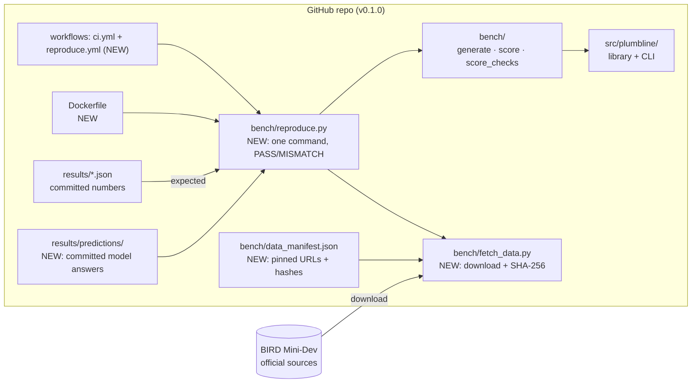

# M4 review: packaging and one-command reproduction

Finished 2026-11-25. Version **0.1.0**. Commands: `python -m bench.reproduce`,
`python -m bench.fetch_data`, `docker build -t plumbline .`.

## What M4 did, in plain words

**Goal (blueprint):** "a fresh clone reproduces the headline number with one command".
Anyone, including an interviewer, should be able to check the 22.1% without trusting me.

1. **Committed the model's answers.** The 500 answers each model wrote (1.6 MB, with the
   model's exact digest and settings) are now in `results/predictions/`. Re-asking the
   model takes 4 GPU hours and could give slightly different answers. The answers are
   the *input* to the experiment, so they're published like a dataset.
2. **Made the data downloadable and checkable.** `bench.fetch_data` downloads BIRD Mini-Dev
   from its official sources (the Hugging Face link pinned to one exact version) and checks
   every file against SHA-256 hashes in `bench/data_manifest.json`. If someone gets a
   different copy, it says so instead of producing quietly different numbers.
3. **One command does everything else.** `python -m bench.reproduce`:
   - downloads and verifies the data;
   - checks the gold queries;
   - builds the catalogs;
   - executes and labels the committed answers;
   - runs Plumbline;
   - prints PASS or MISMATCH for each headline number.
4. **Docker image.** Pinned Python base, runs as a non-root user, holds code only (the
   data is mounted), and runs the reproduction by default.
5. **CI on GitHub.** The existing workflow lints and tests on every push. A new
   *Reproduce results* workflow runs the whole reproduction on a clean GitHub machine, on
   demand and monthly.
6. **README:** a 3-command quick start, the reproduce instructions, and version 0.1.0.
   **Demo:** a timed 90-second recording script in [../demo-script.md](../demo-script.md).

**Acceptance test: passed.** A fresh `git clone` into a new folder, a brand-new venv,
`pip install ".[fanout]"`, then `python -m bench.reproduce --all`:

| Run | Headline numbers matching the committed results | Time |
|---|---|---|
| qwen2.5-coder:7b | **7 / 7** (46 correct, 308 silent wrong, 68 caught, 30 by own rules, 9 / 0 gold false alarms...) | |
| qwen3.5:4b (held out) | **7 / 7** (62 correct, 335 silent wrong, 85 caught, 29 by own rules, 9 / 0 gold false alarms...) | |
| Whole pipeline (data check, 500 gold queries, profiling, both runs) | | **18 min** |

What this test didn't cover: the data download itself. It reused the already-downloaded
copy (via `PLUMBLINE_BIRD_DIR`), whose hashes match the manifest. The GitHub *Reproduce
results* workflow covers the download on a clean machine.

## Project structure after M4

## Problems we hit, and the alternatives

### 1. "One command" can't include asking the model again

- **What happened:** generating answers takes about 4 hours on a GPU, needs Ollama, and
  even at temperature 0 isn't guaranteed to be identical (Atil et al., see M0 review).
- **What we did:** committed the exact answers with the model digest, and reproduce
  everything after generation.
- **Alternatives:**
  - **Regenerate in CI with a hosted model:** costs money per run, and hosted models change
    under the same name, so the numbers drift anyway.
  - **Pin model weights by digest and regenerate locally:** honest, but 4 hours per check.
- **Verdict:** standard practice for benchmark papers is to publish the model outputs.
  Generation stays reproducible separately (`bench.generate`, digest recorded).

### 2. The data can't sensibly live in the repo

- **What happened:** BIRD Mini-Dev is 1.5 GB and licensed CC BY-SA 4.0. The license
  *does* allow sharing it, with attribution and the same license. But bundling would
  bloat the repo and mix licenses with MIT code. (Earlier docs said "not ours to
  redistribute"; that was inaccurate and is corrected.)
- **What we did:** fetch from the official source, pin the version, check hashes.
- **Alternatives:**
  - **Mirror it as a Hugging Face dataset** under CC BY-SA with attribution: faster
    downloads (the official zip is served from Beijing), but another copy to maintain.
  - **Git LFS:** keeps it in the repo, but GitHub's LFS bandwidth quotas make public
    downloads unreliable.
- **Verdict:** source + hashes. If the official URL ever disappears, the hashes still
  say exactly which copy is needed.

### 3. Timeouts depend on the machine

- **What happened:** a query's label can flip from "ran" to "timeout" on a busy PC
  (seen twice during M3 and M4: gold queries timing out at 60 s that take 10 s alone).
- **What we did:** reproduce compares exact counts, but explains a mismatch caused by
  timeouts and says to re-run on an idle machine.
- **Alternatives:**
  - **Compare with a tolerance** (±2 labels): hides real regressions as well as noise.
  - **A longer timeout only for reproduction:** fewer flips, but different settings from
    the original run.
- **Verdict:** exact match plus an explanation. An honest mismatch beats a fuzzy pass.

### 4. Docker on Windows stores everything on C:

- **What happened:** Docker Desktop keeps images and volumes inside a disk file on C:,
  which has about 14 GB free. The data and catalogs need about 2.3 GB during download.
- **What we did:** the image holds only code; the data folder is a mount from G:.
- **Alternatives:**
  - **Move Docker Desktop's disk image** to G: (Settings → Resources → Advanced → Disk
    image location). This is the clean fix, and a one-time setting.
  - **Bake the data into the image:** simple to run, but a 2 GB image, and a CC BY-SA
    layer inside an MIT image.

DOCKER_NOTE

## Open decisions for Derek

1. **Publish v0.1.0:** the repo should be public for the README's install line and the
   Reproduce workflow badge to work. Then push the `v0.1.0` tag.
2. **Record the 90-second demo** from [../demo-script.md](../demo-script.md).
3. **Run the Reproduce workflow once** on GitHub (Actions tab) to prove the clean-machine
   path, including the 806 MB download.
